

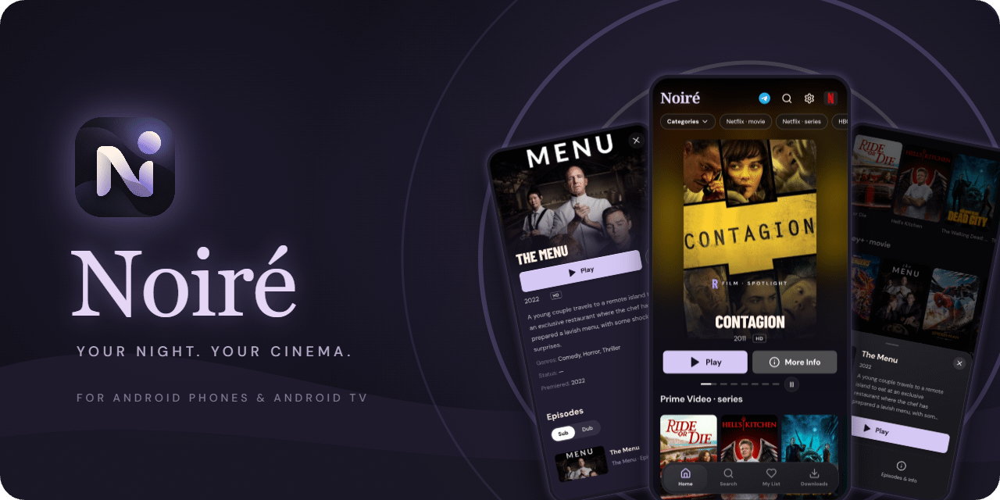

  

  

<a href="https://github.com/shreyagarwal72/Noire/releases/latest">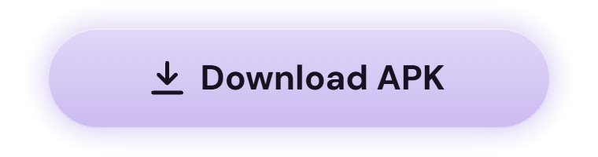</a>

<a href="https://github.com/shreyagarwal72/Noire/releases/latest">Download the latest APK from GitHub Releases</a> · v1.0.0 · about 15 MB

  

**Noiré** is a catalogue browser and video player for Android phones and Android TV. It comes with no content and hosts no videos. You can add an extension from a provider you trust; that extension supplies the titles, artwork and playable links, and Noiré presents them in a calm, cinematic interface. Your player. Your providers.

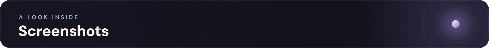

<table>
  <tr>
    <td align="center">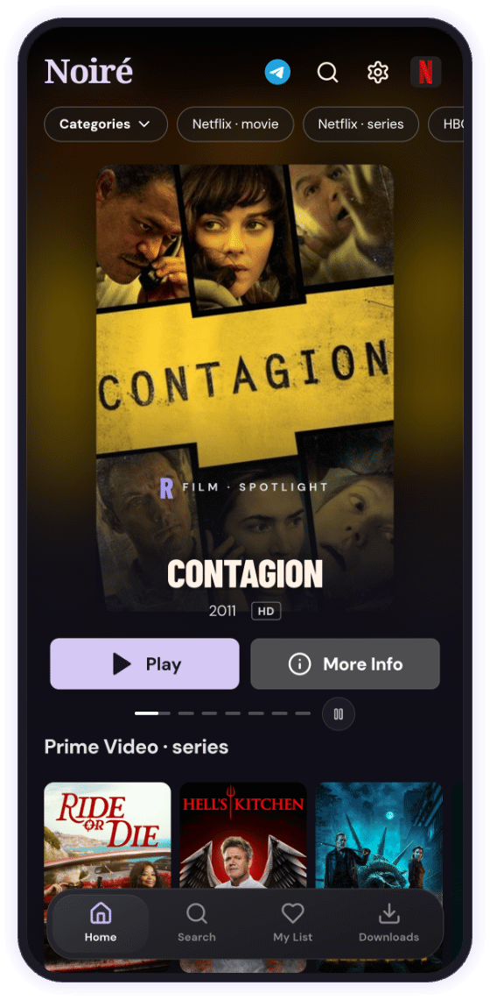 <b>Home</b> · spotlight and rows</td>
    <td align="center">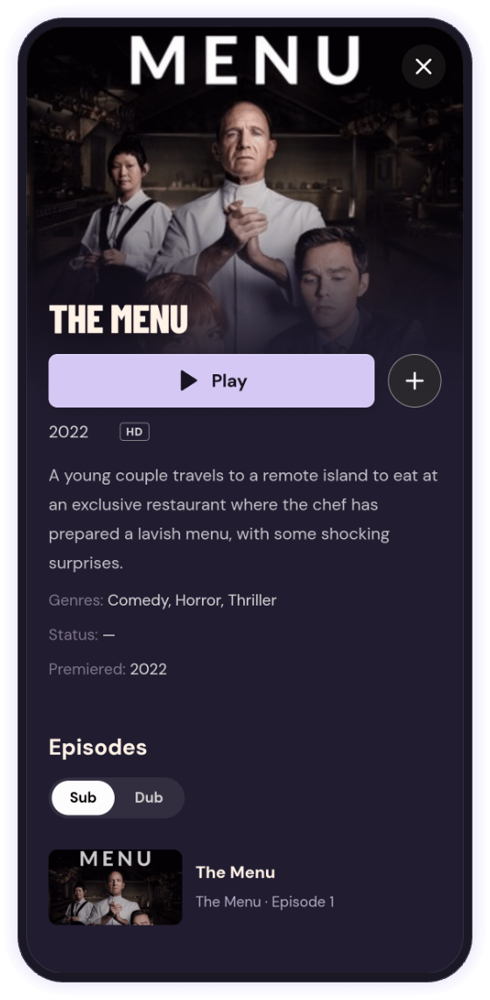 <b>Title</b> · seasons, Sub/Dub</td>
    <td align="center">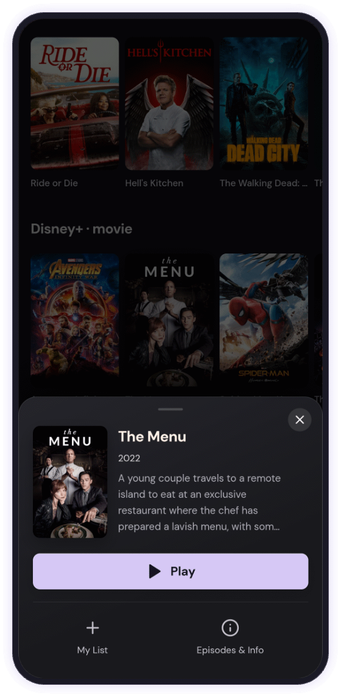 <b>Quick view</b> · synopsis at a glance</td>
  </tr>
  <tr>
    <td align="center">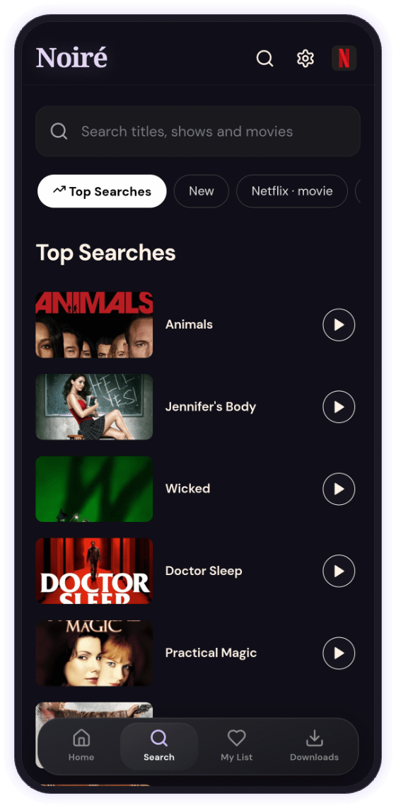 <b>Search</b> · top searches</td>
    <td align="center">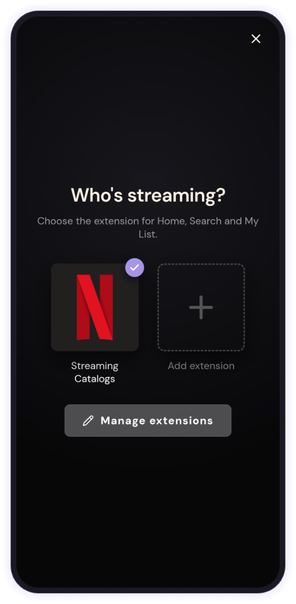 <b>Who’s streaming?</b> · switch extensions</td>
    <td align="center">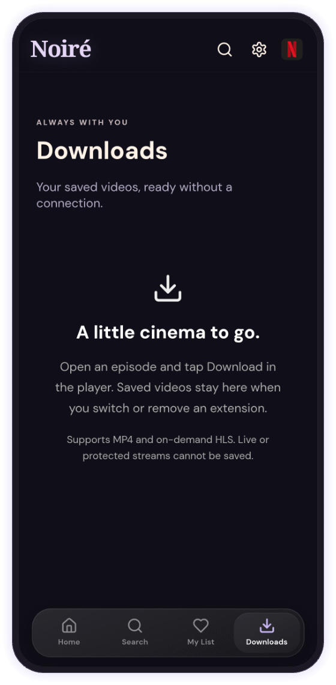 <b>Downloads</b> · a little cinema to go</td>
  </tr>
  <tr>
    <td align="center">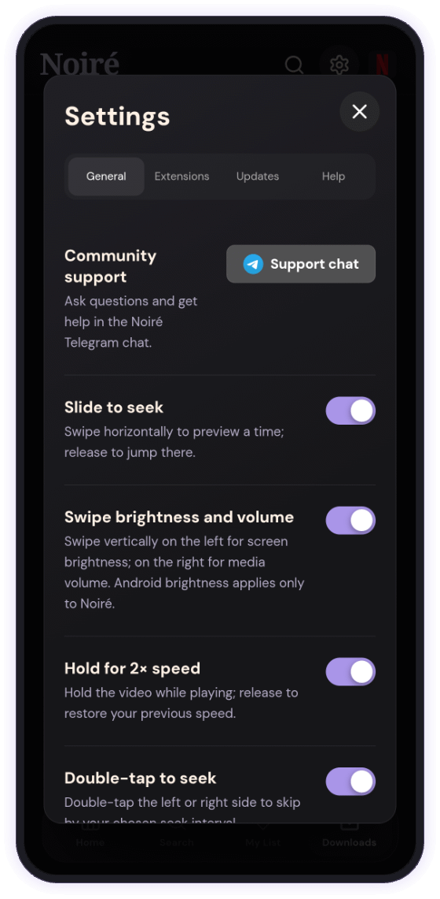 <b>Settings</b> · gestures and support</td>
    <td align="center">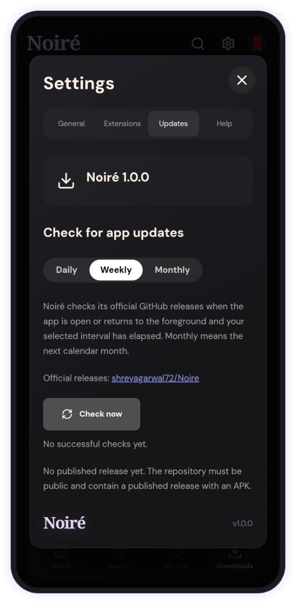 <b>Updates</b> · from GitHub Releases</td>
    <td align="center">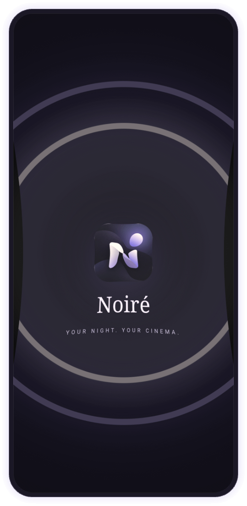 <b>Launch</b> · your night begins</td>
  </tr>
</table>

<b>More screenshots</b>

 
<table>
  <tr>
    <td align="center">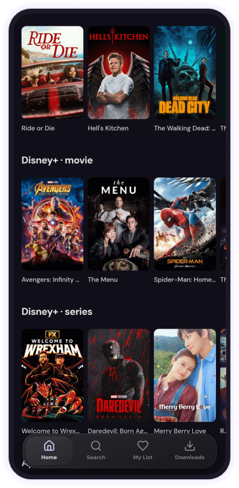 <b>Browse</b> · poster rows</td>
    <td align="center">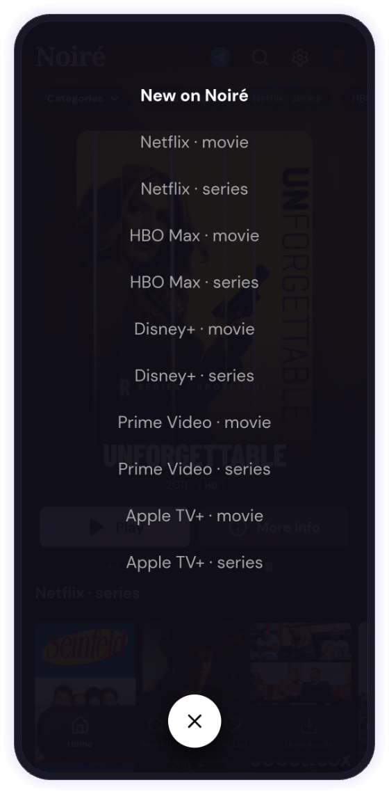 <b>Categories</b> · New on Noiré</td>
    <td align="center">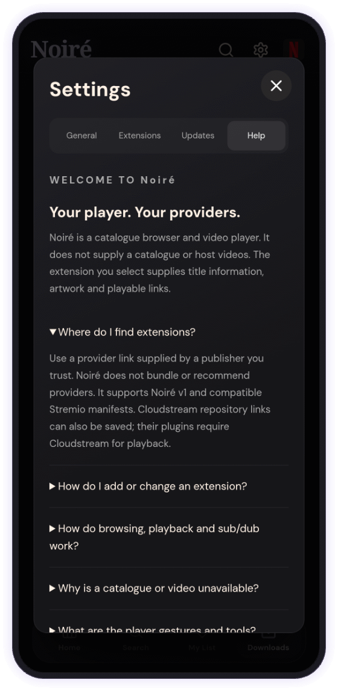 <b>Help</b> · built-in FAQ</td>
  </tr>
</table>

Titles and artwork shown come from a user-installed extension and belong to their respective owners.

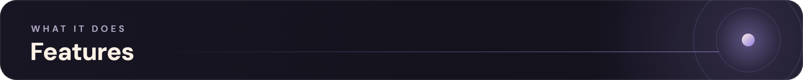

<table>
  <tr>
    <td width="50%">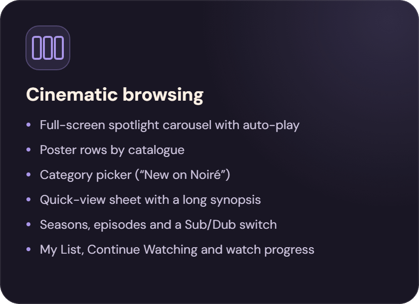</td>
    <td width="50%">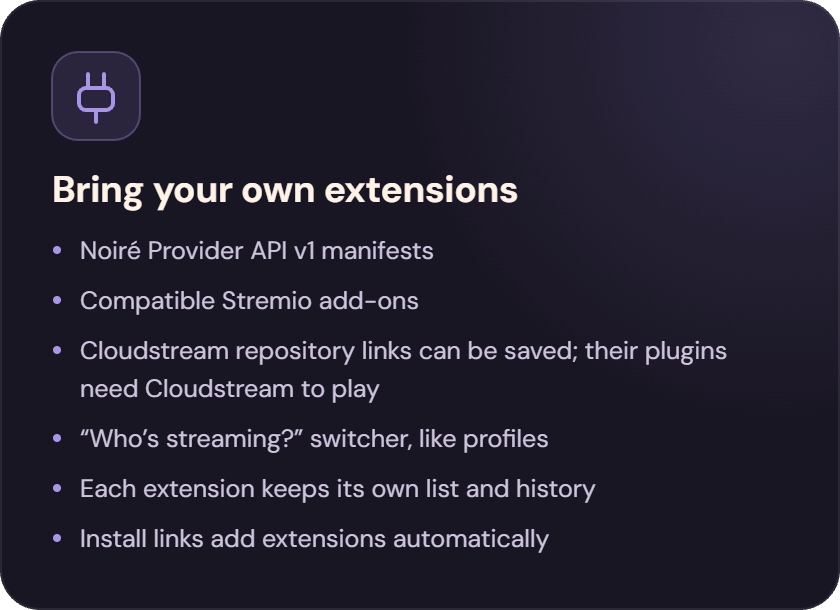</td>
  </tr>
  <tr>
    <td width="50%">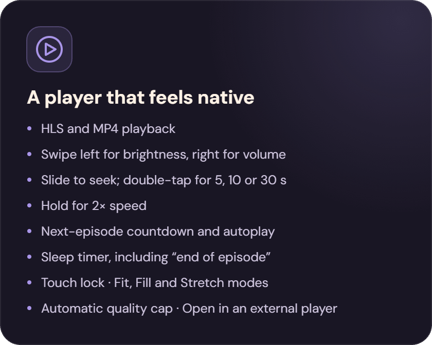</td>
    <td width="50%">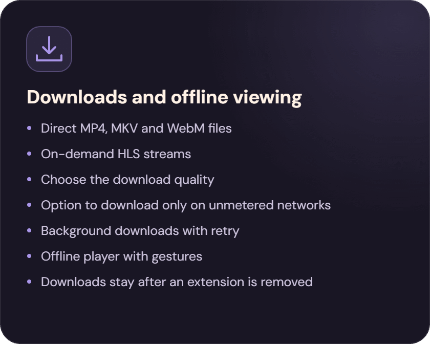</td>
  </tr>
  <tr>
    <td width="50%">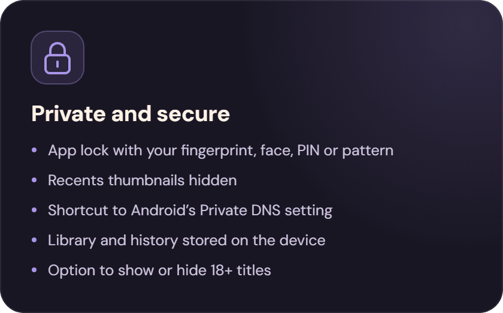</td>
    <td width="50%">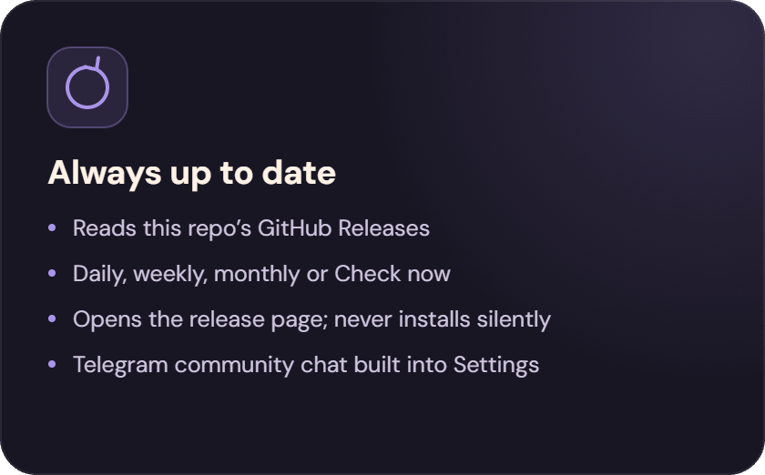</td>
  </tr>
</table>

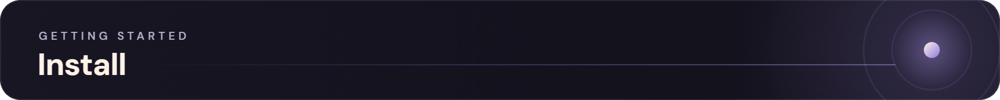

1. Download `noire-1.0.0.apk` from the [latest release](https://github.com/shreyagarwal72/Noire/releases/latest).
2. Open it on your phone and allow **Install unknown apps** for your browser or file manager if Android asks.
3. Open Noiré, tap the extension picture at the top right (or go to **Settings → Extensions**) and paste a manifest link from a provider you trust.
4. Browse, play and download.

**Updates:** <kbd>Settings</kbd> → <kbd>Updates</kbd> → <kbd>Check now</kbd>. Install a new APK over the old one; your library is kept.

| Requirement | Details |
|---|---|
| Android | 8.0 (Oreo) or newer |
| Architecture | ARM · `arm64-v8a` or `armeabi-v7a` |
| Devices | Phones, Android TV and Fire TV (full D-pad navigation) |
| Version | 1.0.0 · about 15 MB |
| Package | `com.stream.noire` |

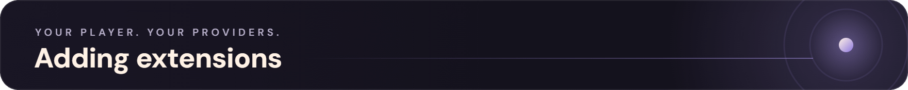

Noiré is the screen; an extension is the source. Each extension is a manifest link from a provider you choose. Paste it in **Settings → Extensions**, or open an install link and Noiré adds it for you. Switch between extensions from **Who’s streaming?**, like profiles. Each one keeps its own list and history.

| Format | Support |
|---|---|
| Noiré Provider API v1 manifests | Browse and play |
| Compatible Stremio add-ons | Browse and play |
| Cloudstream repository links | Can be saved; their plugins need Cloudstream to play |

> [!NOTE]
> Noiré bundles no providers and does not recommend any. Use links only from publishers you trust.

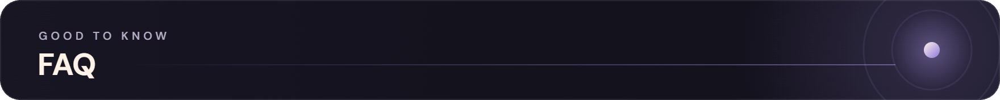

<b>Does Noiré include any movies or shows?</b>

 
No. Noiré is a player. Everything comes from the extension you add.

<b>Where do I find extensions?</b>

 
Use a provider link from a publisher you trust. Noiré does not bundle or recommend providers.

<b>Why won’t a video play?</b>

 
The provider may be offline, its link may have expired, or the file may use a codec the device can’t decode (HEVC, AC3 or DTS in MKV files). Try another source or open it in an external player.

<b>Is my data private?</b>

 
Your library, list and progress stay on the device. Your chosen provider sees your requests. For the device check-in details, see the in-app Help section <i>Privacy and device administration</i>.

<b>Does it work on TV?</b>

 
Yes. It works on Android TV and Fire TV with a remote.

<b>How do I update?</b>

 
Use <b>Settings → Updates</b>, or download the newest release from <a href="https://github.com/shreyagarwal72/Noire/releases/latest">this page</a>.

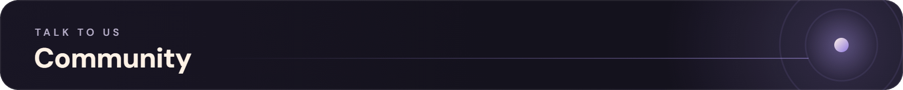

  <a href="https://t.me/Noire_app">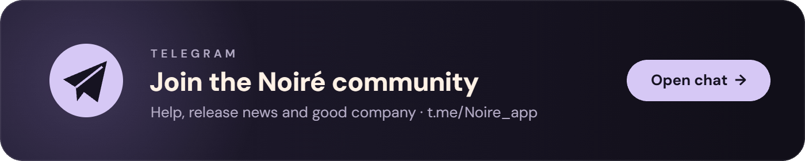</a>
   
  <a href="https://t.me/Noire_app">t.me/Noire_app</a>

<i>Noiré does not host, provide or distribute any media. Titles and artwork in the screenshots come from a user-installed extension and belong to their respective owners. Only use content you have the right to access. Noiré is not affiliated with any streaming service.</i>

 

  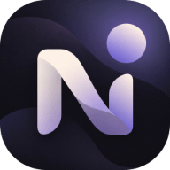
    
  <b>Your library. Your cinema.</b>
   
  Made with ❤️ for the community by Shrey Agarwal and Vythera
   
  © 2026 Noiré

